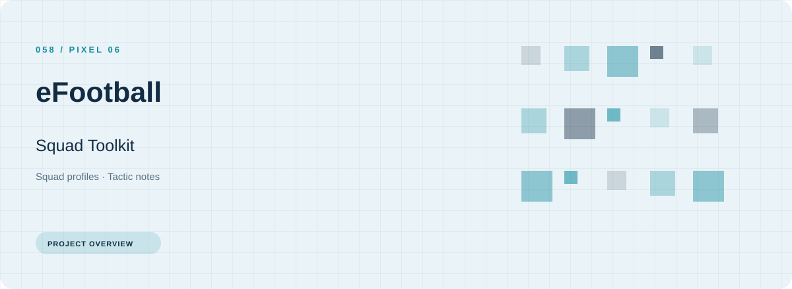
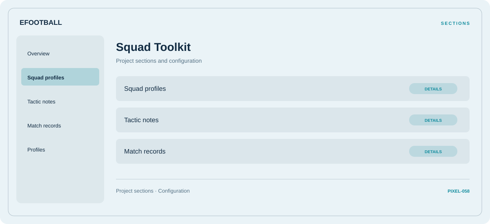

# ⚡ eFootball Squad Toolkit

**Squad profiles · Tactic notes · Match records**

## ⚡ Features

eFootball Squad Toolkit uses a concise workspace for squad profiles, tactic notes, and match records. The feature map follows the same order as the project navigation.

### ⚙️ Squad profiles

Related settings collected into named groups for a clearer configuration workflow.

### 🧩 Tactic notes

A dedicated section for tactic notes and the configuration details associated with that area.

### ⌨️ Match records

Session and activity information grouped by the task or context it belongs to.

## 🖥️ Project navigation

## 📥 Download

The button and cover open the project's download page. Use the information supplied with the downloaded package for installation and release-specific requirements.

## 📚 Project documentation

- [Feature reference](docs/FEATURES.md)
- [Download information](docs/DOWNLOAD.md)
- [Project page](index.html)

---

eFootball Squad Toolkit · Program documentation and download information.
